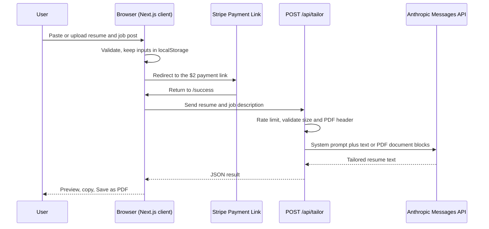

# Resume Tailor

**Paste a resume and a job posting. Get back a version rewritten for that role, ready to save as a PDF.**

[](https://github.com/Zoriyonz/resume-tailor/actions/workflows/ci.yml)
[](LICENSE)


**Live:** <https://resume-tailor-navy-chi.vercel.app> (deployed on Vercel, $2 per resume through a Stripe Payment Link)

## Contents

- [Overview](#overview)
- [Features](#features)
- [How it works](#how-it-works)
- [Tech stack](#tech-stack)
- [Project structure](#project-structure)
- [Getting started](#getting-started)
- [Configuration](#configuration)
- [Scripts](#scripts)
- [Testing and quality gates](#testing-and-quality-gates)
- [Deployment](#deployment)
- [Security and privacy](#security-and-privacy)
- [Design decisions](#design-decisions)
- [Known limitations](#known-limitations)
- [Roadmap](#roadmap)
- [License](#license)

## Overview

Applicant tracking systems filter on keywords, and most people send one generic resume everywhere. Resume Tailor takes your current resume and a job description, asks Claude to rewrite the resume for that posting, and returns plain text you can copy or save as a PDF.

It was built as a small, complete product: a landing page, a paid flow, a server-side AI call and a printable output. It is a prototype. It is live and works, but it is not hardened to the standard of a production SaaS (see [Known limitations](#known-limitations)).

## Features

- **Two input modes per field.** Paste text or upload a PDF, independently for the resume and the job description.
- **Truthful rewriting.** The system prompt forbids inventing employers, titles, dates, degrees, tools or numbers, and tells the model to keep every figure exactly as it appears in the original.
- **ATS-friendly output.** Section headers in capitals, one bullet per line, consistent dates, contact details left as given.
- **One-click PDF.** The result is laid out as a styled HTML page and opened in the browser's print dialog, so "Save as PDF" produces a clean single document with no extra dependency.
- **Pay per use.** $2 per resume through a Stripe Payment Link. Inputs are held in the browser across the redirect and tailored once payment returns the user to the app.
- **Input limits and rate limiting** on the API route (see [Security and privacy](#security-and-privacy)).

## How it works



1. **Input.** `ResumeForm` keeps each field in either text or PDF mode. PDFs are read in the browser, checked for the `%PDF-` header and converted to base64 (`src/lib/useTailorForm.ts`).
2. **Checkout.** Before redirecting to Stripe, both inputs are stored in `localStorage` (text as-is, PDFs as `__PDF__` plus base64). The `/success` page reads them once, deletes them and calls the API.
3. **Tailoring.** `/api/tailor` validates the body (`src/lib/tailor-request.ts`), applies a per-IP rate limit (`src/lib/rate-limit.ts`), and sends text or PDF `document` blocks to the Anthropic Messages API with the system prompt.
4. **Output.** The text comes back to the browser. `src/lib/pdf.ts` parses it into a header and sections and renders a print-styled page for "Save as PDF".

## Tech stack

| Area      | Choice                                                                         |
| --------- | ------------------------------------------------------------------------------ |
| Framework | Next.js 16 (App Router), React 19                                              |
| Language  | TypeScript 5 in strict mode                                                    |
| Styling   | Tailwind CSS 4 with hand-written CSS in `globals.css`                          |
| AI        | Anthropic Messages API (`claude-sonnet-4-20250514`), called with plain `fetch` |
| Payments  | Stripe Payment Links                                                           |
| Testing   | Vitest                                                                         |
| Quality   | ESLint (`eslint-config-next`), Prettier, GitHub Actions                        |
| Hosting   | Vercel                                                                         |
| Packages  | pnpm 10, Node 20 or newer (`.nvmrc` pins 22)                                   |

## Project structure

```
resume-tailor/
├── src/
│   ├── app/
│   │   ├── api/tailor/route.ts     POST handler: rate limit, validate, call Anthropic
│   │   ├── success/page.tsx        Post-payment page that runs the tailoring
│   │   ├── layout.tsx              Fonts and metadata
│   │   ├── page.tsx                Landing page and form
│   │   └── globals.css
│   ├── components/                 Header, Hero, ResumeForm, PayModal, OutputSection, Footer
│   ├── lib/
│   │   ├── tailor-request.ts       System prompt, validation, message construction (tested)
│   │   ├── rate-limit.ts           Fixed-window in-memory limiter (tested)
│   │   ├── useTailorForm.ts        Form state, PDF reading, checkout hand-off
│   │   ├── runTailor.ts            Client call to /api/tailor
│   │   ├── pdf.ts                  Output parsing and print-to-PDF layout
│   │   └── constants.ts            Model name, Stripe link, dev bypass flag
│   └── types/index.ts
├── .github/workflows/ci.yml        Format, lint, typecheck, test, build
├── .env.example
└── vitest.config.ts
```

## Getting started

Requires Node 20 or newer and [pnpm](https://pnpm.io) 10.

```bash
git clone https://github.com/Zoriyonz/resume-tailor.git
cd resume-tailor
pnpm install
cp .env.example .env.local     # then set ANTHROPIC_API_KEY
pnpm dev                       # http://localhost:3000
```

The checkout step sends you to the real Stripe Payment Link. To exercise the AI flow locally without paying, set `BYPASS_STRIPE` to `true` in `src/lib/constants.ts` for your local session and do not commit that change.

## Configuration

| Variable            | Required | Used by                       | Purpose                                                    |
| ------------------- | -------- | ----------------------------- | ---------------------------------------------------------- |
| `ANTHROPIC_API_KEY` | Yes      | `src/app/api/tailor/route.ts` | Authenticates the Anthropic call. Read on the server only. |

Other settings live in `src/lib/constants.ts`: the model name, the Stripe Payment Link URL (a public link, not a secret) and the `BYPASS_STRIPE` development flag.

## Scripts

| Command             | What it does                                   |
| ------------------- | ---------------------------------------------- |
| `pnpm dev`          | Start the dev server                           |
| `pnpm build`        | Production build                               |
| `pnpm start`        | Serve the production build                     |
| `pnpm lint`         | ESLint                                         |
| `pnpm typecheck`    | `tsc --noEmit`                                 |
| `pnpm test`         | Vitest unit tests                              |
| `pnpm format`       | Format everything with Prettier                |
| `pnpm format:check` | Fail if anything is not formatted (used in CI) |

## Testing and quality gates

`src/lib/tailor-request.test.ts` covers input validation, size limits, base64 normalisation, PDF header checks and message assembly. `src/lib/rate-limit.test.ts` covers the limiter windows and client-IP parsing. The tests run without network access or an API key.

Every push and pull request runs the same chain in GitHub Actions: `format:check`, `lint`, `typecheck`, `test`, `build`.

## Deployment

The app deploys to Vercel as a standard Next.js project. Set `ANTHROPIC_API_KEY` in the project's environment variables. No other server configuration is needed.

## Security and privacy

- The API key is read only in the server route and is never sent to the browser. `next.config.ts` deliberately exposes no environment variables to the client bundle.
- The API route rejects non-JSON bodies, missing fields, oversized text (60,000 characters) and oversized PDFs (about 10 MB), and verifies that uploaded PDFs really start with `%PDF-`.
- Requests are rate limited to 10 per hour per IP. The limiter is in memory, so on serverless hosting each instance counts separately. It deters casual abuse and is not a billing-grade control.
- Upstream error details are not forwarded to the client; only the error message is.
- Resumes are processed in the request and are not stored by this app. While a user is on the Stripe page, the inputs sit in that browser's `localStorage` and are deleted as soon as the success page reads them. Anything sent to the Anthropic API is subject to Anthropic's own data policy.

## Design decisions

- **Plain `fetch` instead of the SDK.** The app makes one call. Keeping it as `fetch` avoids a dependency and keeps the request body fully visible, including the PDF `document` blocks.
- **Pure request module.** Validation and message construction live in `tailor-request.ts` with no Next.js imports, so they are unit tested without a server.
- **Print-to-PDF instead of a PDF library.** The browser's print engine gives selectable text and good typography with no bundle cost, at the price of relying on the user's print dialog.
- **A truthfulness rule above all other prompt instructions.** An earlier prompt asked for "metrics where possible", which invites invented numbers. It now forbids adding any figure that is not in the source resume.

## Known limitations

- **The payment gate is enforced in the browser, not on the server.** `/api/tailor` does not verify that a Stripe payment happened, so anyone who calls the endpoint directly gets a free result (within the rate limit). Fixing this means moving to Stripe Checkout Sessions, confirming `payment_status` server-side and issuing a single-use token.
- **The rate limiter is per instance** (see above).
- **Very large PDFs may not survive checkout.** They are held in `localStorage`, which browsers cap at a few megabytes. In that case the form asks the user to paste text instead.
- **Output quality depends on the model.** Always review the result before sending it to an employer.
- **The model identifier is pinned** in `constants.ts` and will need updating when Anthropic retires it.

## Roadmap

- Verify payments server-side with Stripe Checkout Sessions and webhooks.
- Stream the response so long resumes appear as they are written.
- A diff view that highlights what changed from the original.
- Multiple output templates.

## License

[MIT](LICENSE) © 2026 Zoriyon Zion
